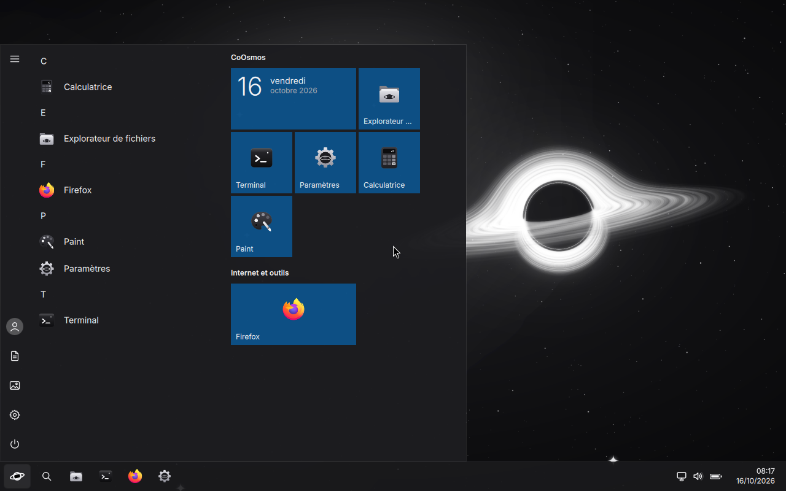
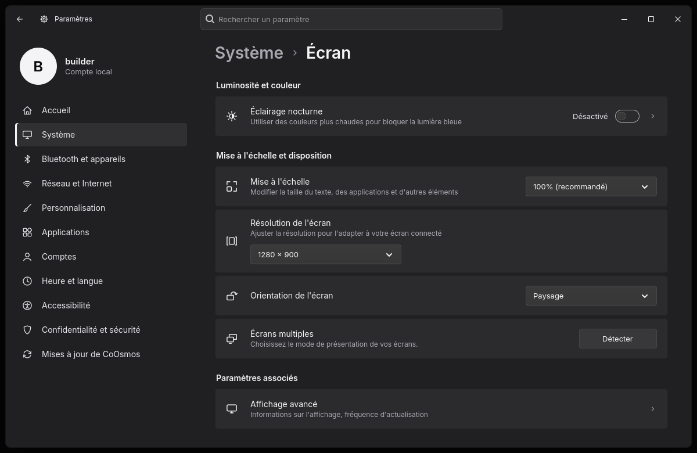
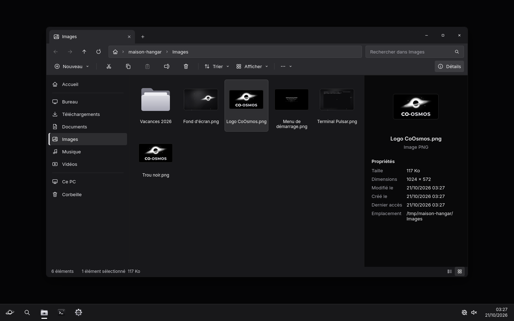
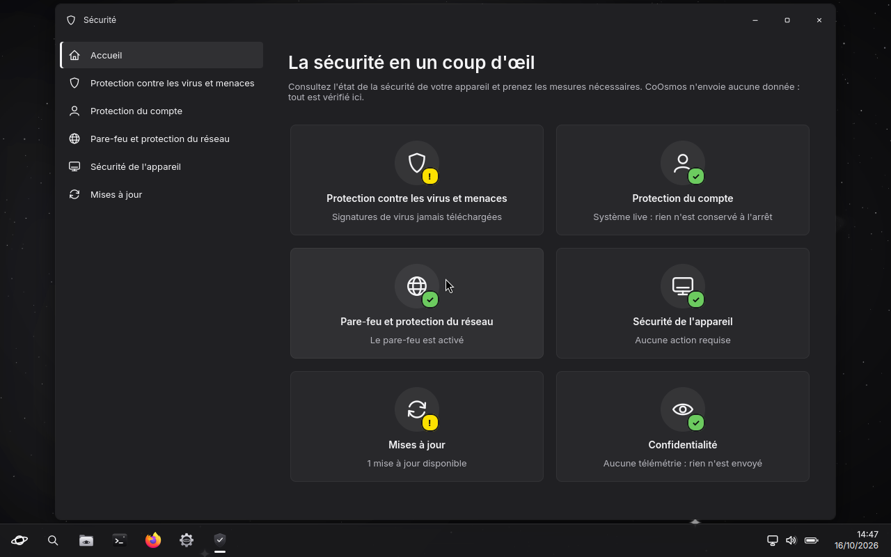
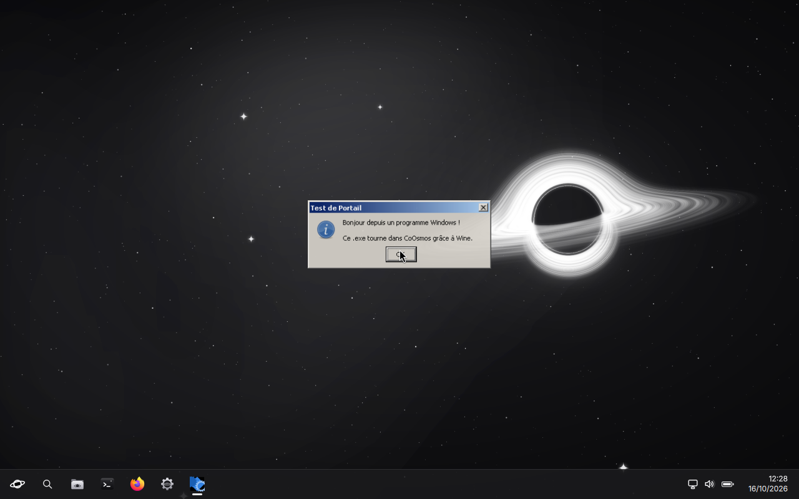
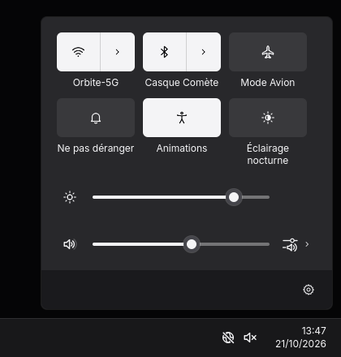

<h1 align="center">🌌 CoOsmos</h1>

  <b>Tout ce que vous connaissez. Rien de ce qui vous surveille.</b> 
  Le système d'exploitation qui se manie comme Windows, construit sur Arch Linux.

  
  
  
  
  

  <a href="https://github.com/Bicode-dev/CoOsmos/releases/latest"><b>⬇️ Télécharger Hyperespace</b></a>
  &nbsp;·&nbsp;
  <a href="https://bicode-dev.github.io/CoOsmos/"><b>🌐 Le site de CoOsmos</b></a>

---

## Aperçu

*Le menu Démarrer : toutes les applications par ordre alphabétique, les vignettes épinglées à droite, l'alimentation en bas.*

*Paramètres › Écran : luminosité, éclairage nocturne, mise à l'échelle, résolution, orientation, écrans multiples.*

*L'Explorateur de fichiers : onglets, barre de commandes, volet de navigation et volet de détails.*

*La sécurité en un coup d'œil : antivirus, protection du compte, pare-feu, sécurité de l'appareil, mises à jour.*

*Un programme Windows, lancé d'un double-clic sur son `.exe`, directement sur le bureau de CoOsmos.*

*Les réglages rapides : Wi-Fi et Bluetooth avec leur volet, éclairage nocturne, luminosité, volume et sortie audio.*

---

## Le problème, tel qu'il se pose

Vous aimez Windows pour ce qu'il a de familier : le menu Démarrer, la barre des tâches, des Paramètres où
chaque chose est rangée à sa place, un Explorateur qui ne vous surprend jamais. Vous l'aimez beaucoup moins
pour le compte qu'il exige, les publicités dans le menu Démarrer et les données qu'il envoie.

**CoOsmos garde le premier et retire le second.** Le même bureau, les mêmes réflexes, vos programmes Windows
d'un double-clic — et rien qui parte de votre PC.

## Ce qu'il contient

- **Menu Démarrer, barre des tâches, réglages rapides, notifications**, <kbd>Win</kbd>+<kbd>V</kbd>, <kbd>Win</kbd>+<kbd>R</kbd>
- **Paramètres** : les mêmes pages que Windows 11, dans le même ordre
- **Explorateur de fichiers**, avec « Retirer le périphérique en toute sécurité » pour les clés USB
- **Vos programmes Windows** : un double-clic sur un `.exe` suffit, l'environnement est prêt dès le premier démarrage
- **Sécurité** : antivirus prêt d'office, pare-feu, chiffrement du disque façon BitLocker, Secure Boot
- **Mises à jour sans mot de passe**, et un point de restauration avant chacune
- **Les outils du quotidien** : Gestionnaire des tâches, Outil Capture d'écran (avec vidéo), Paint, Calculatrice, Terminal
- **Firefox protégé** : uBlock Origin et Privacy Badger, et un bouton pour passer d'une empreinte Windows à une empreinte Linux
- **Dépannage** : mode sans échec, « Réparer l'ordinateur », et une mise à niveau qui garde fichiers, paramètres et applications

## Installer CoOsmos

Comptez une **clé USB de 8 Go** ou plus (son contenu sera effacé) et une vingtaine de minutes.

1. **Créez la clé avec Hyperespace** — [téléchargez-le](https://github.com/Bicode-dev/CoOsmos/releases/latest)
   (Windows : un seul fichier ; Linux : une archive). Il télécharge la dernière version de CoOsmos, vérifie
   qu'elle est intacte, l'écrit sur la clé et relit tout.
2. **Démarrez le PC sur la clé** : branchez-la, redémarrez, et appuyez aussitôt sur la touche du menu de
   démarrage (souvent <kbd>F12</kbd>, <kbd>F11</kbd>, <kbd>F8</kbd> ou <kbd>Échap</kbd>). CoOsmos démarre en
   direct, sans rien toucher au disque : vous pouvez tout essayer.
3. **Installer maintenant** : sur un disque entier ou à côté de Windows, chiffrement au choix. CoOsmos déjà
   installé ? Choisissez « Mise à niveau ».
4. **Premier démarrage** : pays, clavier, nom du PC, votre compte et sa photo. Puis le bureau.

> **Secure Boot activé ?** Pas besoin de le couper. Au premier démarrage sur la clé, un écran bleu s'ouvre une
> seule fois : « Enroll key from disk », puis `CoOsmos-SecureBoot.cer`, « Continue », « Yes », « Reboot ».
> Une fois CoOsmos installé, il revient une fois : « Enroll MOK », puis le mot de passe `orbite`.

| Processeur | Mémoire | Disque | Démarrage |
|---|---|---|---|
| 64 bits (Intel ou AMD) | 4 Go (8 conseillés) | 20 Go libres, ou un disque entier | UEFI ou BIOS, Secure Boot |

## Ce qu'il ne fait pas

- **Aucun compte** à créer : un compte local, créé au premier démarrage.
- **Aucune donnée envoyée** : ni diagnostic, ni identifiant, ni statistique.
- **Aucune publicité** : pas de suggestions dans le menu Démarrer, pas d'applications installées en douce.

## Licence

© 2026 Bicode_DEV. Vous pouvez **utiliser** CoOsmos et le **redistribuer tel quel** ; le copier, le modifier
ou réutiliser son code, ses visuels ou ses textes demande l'accord écrit de Bicode_DEV. Les logiciels d'autres
auteurs qu'il contient gardent leur propre licence, et pour les parties sous GPL, c'est la
[GNU GPL v3](licences/GPL-3.0.txt) qui s'applique. Le texte complet : [LICENCE.md](LICENCE.md).

Ce dépôt présente CoOsmos et permet de le télécharger ; il ne contient pas son code source.

